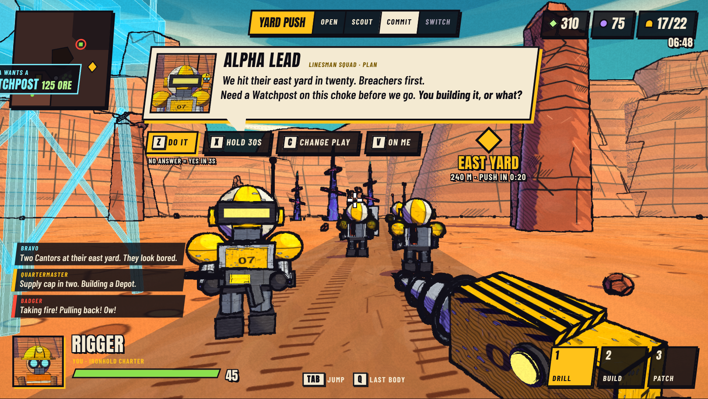
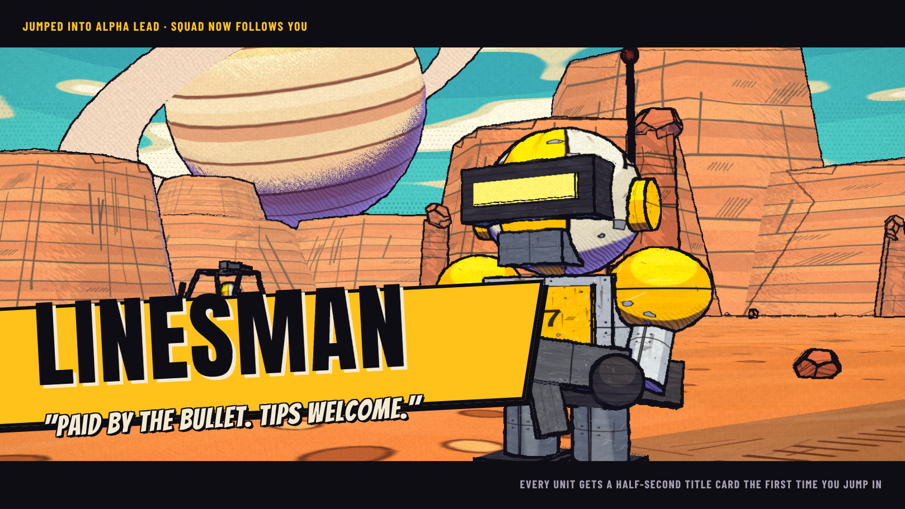

# Ore Else (working title)

A first-person RTS for the browser. You start as a single worker, build a base and an army, and can jump into any unit you own while AI teammates run recognisable RTS strategies and call out their plans. Comic-ink visuals, chunky cartoon units.

The project is in the design phase. No game code yet.

- [Game design document](docs/design/GAME_DESIGN.md)
- [Live look test](docs/design/mockups/index.html): a real-time 3D mockup. Open it in a browser (needs an internet connection to load three.js).

