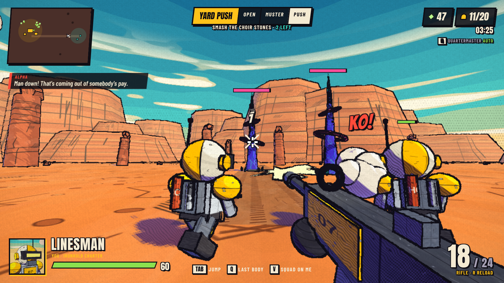
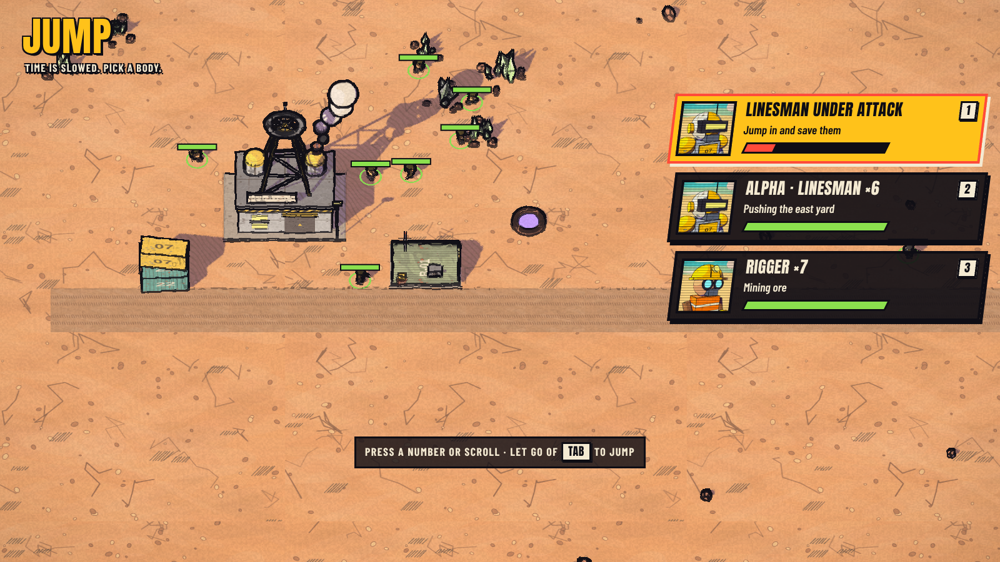
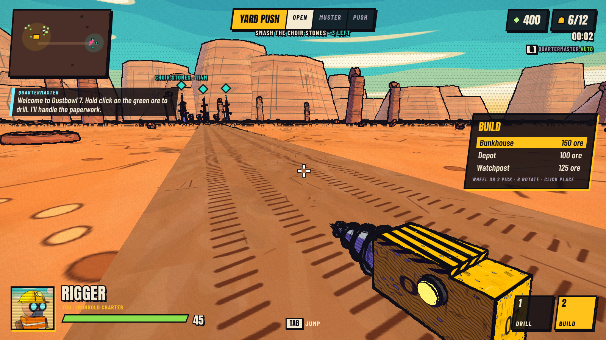

# Ore Else (working title)

A first-person RTS for the browser. You start as a single worker with a drill, build a base and an army, and can jump into any unit you own while AI teammates run recognisable RTS plans and call them out. Comic-ink visuals, chunky cartoon units.



## Play it

```
npm install
npm run dev      # http://localhost:5173, rebuilds on every reload
npm run build    # type-checks and writes dist/index.html, a single self-contained file
```

Needs a keyboard and mouse. `dist/index.html` can be opened straight from disk or hosted anywhere.

## What is in the first playable

One skirmish as the Ironhold Charter against a Veyl outpost. Smash the three Choir Stones down the east road before the Veyl flatten your Headframe.

- **Rigger**: drill ore by hand, place Bunkhouses, Depots and Watchposts, weld them up faster, patch damage.
- **Linesman**: rifle with a 24-round magazine and headshot crits.
- **Jump**: hold `Tab` for the slowed-down overview and pick a body, press `F` on a unit you are looking at, or `Q` to go back to your last body. If your body dies you drop into the nearest one.
- **Quartermaster**: an AI that runs the economy for you (build order, supply, training). `G` turns it off if you want to do it yourself.
- **Squad plans**: Alpha squad pitches a push when it has the numbers. `Z` agrees, `X` holds, `V` makes them follow you, middle click sends them somewhere.
- **The Veyl**: Cantors with regenerating shields guard the outpost and raid your base in growing waves. Choir Stones shoot back.

| Key | Action |
| --- | --- |
| `WASD`, `Shift` | Move, sprint |
| Click | Drill, weld, shoot |
| `1` `2` | Drill, build menu (wheel to pick, `R` to rotate) |
| `E` | Train at the Headframe or a Bunkhouse |
| `Tab` `F` `Q` | Jump |
| `Z` `X` `V`, middle click | Squad plans and orders |
| `G` | Quartermaster on or off |





## How it is built

TypeScript and three.js, bundled by esbuild into one HTML file. No art or sound assets: models are built from primitives, textures are painted on canvases at boot, and sound is synthesised.

- `src/gfx.ts`: the comic-ink renderer. Toon shading with hatched shadows, a real shadow map, and a post pass that inks outlines from depth and normals.
- `src/models.ts`: units, structures, the world and first-person view-models.
- `src/game.ts`: the simulation. Economy, unit AI, combat, raids, the Quartermaster, squad plans and jumping between bodies.
- `src/hud.ts`, `src/style.css`, `src/page.html`: the HUD and menus.
- `src/audio.ts`: sound effects.

## Design

- [Game design document](docs/design/GAME_DESIGN.md)
- [Look test](docs/design/mockups/index.html): the mockup scenes the renderer was developed against.

Not in yet: playing as the Veyl, more unit types, Flux as a second resource, the other playbooks, and multiplayer.
