# Ore Else (working title)

A first-person RTS for the browser. You start as a single worker with a drill, build a base and an army, and can jump into any unit you own while AI teammates run recognisable RTS plans and call them out. Comic-ink visuals, chunky cartoon units.

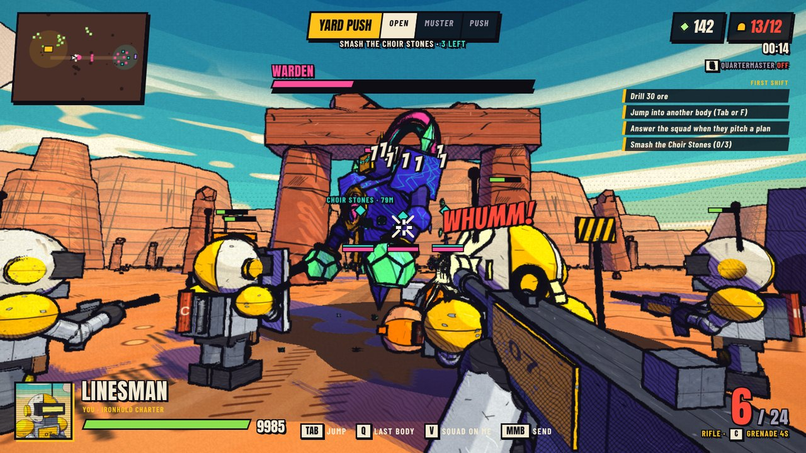

## Play it

```
npm install
npm run dev      # http://localhost:5173, rebuilds on every reload
npm run build    # type-checks and writes dist/index.html, a single self-contained file
```

Needs a keyboard and mouse. `dist/index.html` can be opened straight from disk or hosted anywhere.

## What is in the game

One skirmish as the Ironhold Charter against a Veyl outpost. Smash the three Choir Stones down the east road before the Veyl flatten your Headframe. A match runs ten to twenty minutes, and the day turns to sunset while you play.

**Your side, the Ironhold Charter**

- **Rigger**: drill ore by hand into a 15-ore pack (21 with Deep Buckets) and walk it to the Headframe to bank it, place buildings, weld them up faster, patch damage. A drilled-out seam settles and comes back at a third of its ore after a couple of minutes. Right-click with the drill out is a jackhammer kick that throws a raider back and cracks scenery.
- **Linesman**: rifle with a 24-round magazine, aim-down-sights, headshot crits and a grenade on a cooldown. Every gun opens its crosshair under sustained fire, so short bursts hit harder at range, and every hit you land shoves the target and costs it a beat.
- **Breacher**: scattergun and a riot shield. Hold right-click to brace behind the shield, click while braced to bash. Damage soaked on the shield charges Payback, which comes out with the next blast for up to 80% more.
- **Gantry**: a two-legged walker from the Foundry with a cannon on each side. Click fires explosive shells, Right-click lobs a two-shell salvo that bursts where it lands, `C` stomps and throws everything nearby off its feet.
- **Longshot**: sniper from the Bunkhouse once a Foundry stands. Hold right-click for the scope; a head shot drops most things, and the round carries on through up to two more bodies behind the first.
- **Patch**: medic from the Bunkhouse once a Machine Shop stands. Mends the most hurt ally nearby on their own; as the Patch, `C` tops up everyone around you and rivets fired at a hurt friend mend them instead.
- **Everything breaks**: all 339 pieces of scenery inside the map take damage, from fuel drums (which explode and set each other off) and crates to rock spires, the road arch, buttes and the enemy brood domes. Big rocks crumble in stages. Rubble is simulated: chunks fall, bounce, tumble, pile up against walls, get thrown by blasts and kicked when you walk through them. The Rigger's drill works on rock too. Building health follows classic RTS proportions (a production building takes a rifleman about 100 seconds).
- **Buildings and tech tree**:
  1. Headframe trains Riggers, and more can be built on far ore fields as new bases. Bunkhouse trains Linesmen. Depot adds beds. Watchpost is a gun tower.
  2. Machine Shop (needs a Bunkhouse) unlocks Breachers and Patches and sells Hollow Points and Plating.
  3. Foundry (needs a Machine Shop) unlocks Longshots, builds Gantry walkers and sells Tungsten Core and Reactive Plating.

**Their side, the Veyl Chorus**

- **Cantor**: shielded melee raider that dashes in. A bot-driven Cantor's sweep also cuts half as deep into up to two more bodies pressed against its target, which is what lets it trade with a swarm.
- **Lancer**: keeps its distance and fires slow bolts you can sidestep.
- **Warden**: a boss that wakes when the first Stone falls and later walks with the raids. Stay out of the pink ring.
- **Reed Gate**: where their reinforcements arrive. Knock it down and the raids shrink.

**What makes it a first-person RTS**

- **Jump**: hold `Tab` for the slowed-down overview and pick a body, press `F` on a unit you are looking at, or `Q` to go back to your last body. If your body dies you drop into the nearest one.
- **Quartermaster**: an AI that runs the economy for you (build order, supply, upgrades, training). `G` turns it off if you want to do it yourself.
- **Squad plans**: Alpha squad pitches a plan when it has the numbers: Yard Push down the road, Back Door round the north ridge, or Last Shift when one Stone is left. `Z` agrees, `C` picks the other route, `X` holds, `V` makes them follow you, middle click sends them somewhere. A push that breaks nothing makes the squad wait for two more bodies before it pitches the next one, up to six more, so the army builds up instead of trickling into the outpost.
- **Raids**: the Veyl hit your base in growing waves from the east road or the north ridge, with a fifteen second warning.
- Three difficulty levels, an adaptive synthesised soundtrack, and mouse and volume settings on the pause screen.

| Key | Action |
| --- | --- |
| `WASD`, `Shift`, `Space` | Move, sprint, dash |
| Click | Drill, weld, shoot |
| Right-click | Aim the rifle, raise the shield |
| `C` | Grenade (Linesman) |
| `1` `2` | Drill, build menu (wheel to pick, `R` to rotate) |
| `E` `T` | Train or buy upgrades at the building you are looking at |
| `Tab` `F` `Q` | Jump |
| `Z` `C` `X` `V`, middle click | Squad plans and orders |
| `G` | Quartermaster on or off |
| `Esc` | Pause and settings |

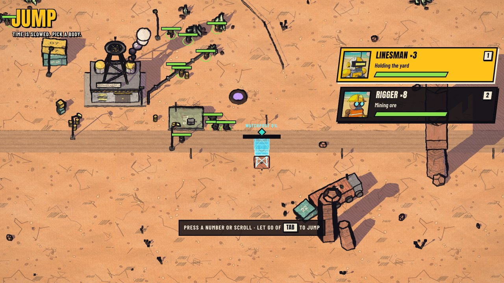

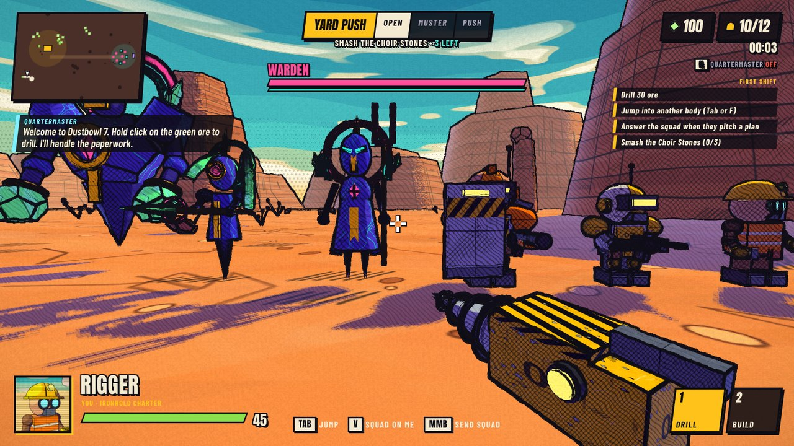

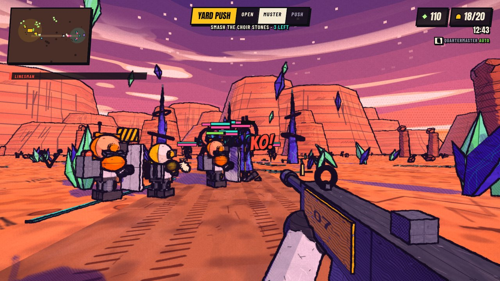

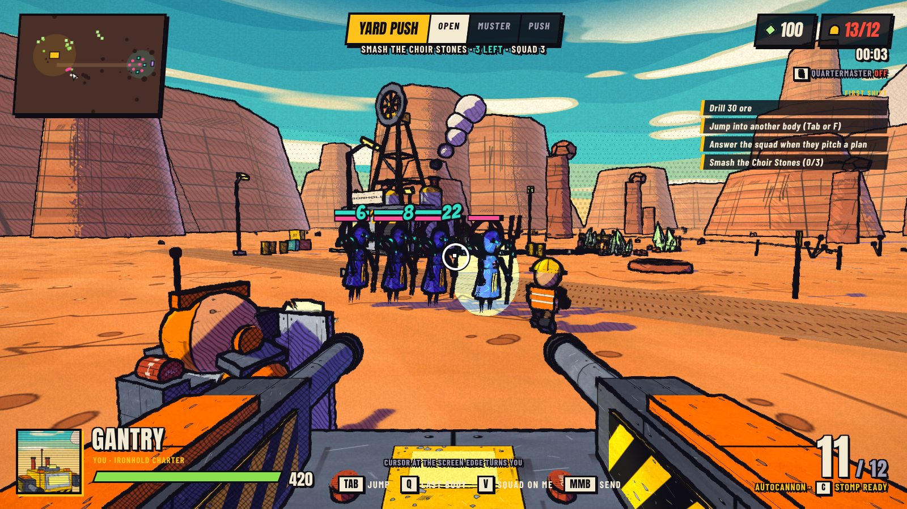

## How it is built

TypeScript and three.js, bundled by esbuild into one HTML file. No art assets: models are sculpted in code and textures are inked and painted on canvases at boot. Sound effects are CC0 recordings and designed samples in `assets/sfx` (sources and licences in `assets/sfx/CREDITS.md`, rebuilt by `python3 tools/sfx/make.py`), inlined into the page by the build and layered with synthesised bass; the music is synthesised. `node tools/sfx/board.mjs` builds `dist/sound-board.html`, which plays every effect old against new.

- `src/gfx.ts`: the comic-ink renderer. Three flat tones with hatching only where a pen would put it, a real shadow map, and a post pass that inks outlines from depth and normals: heavy on silhouettes, lighter on creases, with pen pressure along the line.
- `src/sculpt.ts`: the sculpting kit. Lathed, swept, pressed and bevelled forms with smooth shading, so the only hard lines are deliberate creases.
- `src/skins.ts`: the hand-inked skins. Brushed colour, tapered pen strokes, edge wear, hatching, seams, rivets and stencils, in cuts for boxes, turned forms and domes.
- `src/units.ts`: the cast, for both sides.
- `src/models.ts`: structures, the world, first-person view-models and the unit atlas. Models are merged per material when built, and units are cloned from a cached prototype.
- `src/data.ts`: stat tables, shared types and map constants.
- `src/game.ts`: the simulation and the player. Entities, combat, effects, the first-person bodies and jumping between them.
- `src/hitfx.ts`: getting shot, dying, and what a bullet does where it lands. Flinches are springs laid over a body's normal pose; deaths are chosen by what killed it (a shot, a headshot, a blast) and by how the body is built; bullets leave sparks, chips, dirt and marks that match what they hit. All of it is for show: it never touches health or the match's seeded random numbers, and the match server skips it. It works through a model's named parts (body, head, arms, legs, halo), so a new model that keeps the names gets it all.
- `src/director.ts`: the strategy layer. The Quartermaster, the Veyl raid planner, squad playbooks, callouts and chatter.
- `src/hud.ts`, `src/style.css`, `src/page.html`: the HUD and menus.
- `src/audio.ts`: sound effects (sampled, with the old synthesised set as a fallback), voices and the step-sequenced music.

## Design

- [Game design document](docs/design/GAME_DESIGN.md)
- [Look test](docs/design/mockups/index.html): the mockup scenes the renderer was developed against.

Not in yet: Flux as a second resource and more maps.

## Playing as the Veyl

Pick **The Veyl** on the Skirmish tab and press **Start singing**. Ironhold is run by bots: the Quartermaster digs, builds, trains and sends its squads at you, and you win by breaking every Headframe.

The Veyl run the same kind of economy as the yard, with their own pieces:

| Ironhold | The Veyl | What it does |
| --- | --- | --- |
| Rigger | **Tender** (50) | Hums ore from a seam into a glass sling with 1, carries it to a Choir Stone, and sings buildings up with 2 |
| Headframe (400) | **Choir Stone** (400) | Where ore is banked and Tenders wake. Seed one on a far field to expand. Lose them all and the song ends |
| Depot | **Hush Well** (100) | Room for eight more voices |
| Bunkhouse | **Brood Pit** (150) | Wakes Cantors (75) and Lancers (80) |
| Watchpost | **Thorn Spire** (110) | Shoots anything that walks up |
| Machine Shop | **Ward Pylon** (150) | Cuts damage to nearby buildings, and teaches Keener Edges, Thicker Glass, Quick Step and Twin Thorns |
| Foundry | **Reed Gate** (200) | Wakes the Warden (340), and teaches Bright Edges, Deep Glass, Long Breath (Lancers reach further) and Quick Bloom (shields grow back twice as fast) |

The Choir Stone also teaches **Low Hum** (Tenders gather 30% faster) and **Wide Chorus** (more room for voices). Press G to hand the Chorus to the Conductor, who then grows it the way the bot Chorus does. The Chorus Lead pitches pushes the same way the Squad Lead does (Z yes, X hold, V follow me, middle mouse to point), the Conductor warns you when Ironhold boots are coming, and the Watcher calls out when your buildings are hit.

**Balance.** A paid Veyl fighter that the AI drives takes 40% less from each hit and hits 45% harder than the free raiders the bot Chorus breeds in an Ironhold skirmish, so equal ore buys roughly an even fight. The body you drive yourself takes hits at face value, the same as an Ironhold one, so you can't stack the bonus on your own hero. Workers on both sides run from raiders and nearby guards come to help, and a bot Ironhold facing a Veyl player puts up a Watchpost early, so a lone hero can't wipe the economy. On Double shift a bot side facing a person gets 15% more from each load; on Day and Night nobody gets extra ore. A half-built site can be shot down, and an unfinished Choir Stone doesn't keep the Chorus alive. Single player as Ironhold is unchanged.

`node test/veyl.mjs` plays a solo Veyl run in a browser, and `node tools/eco.cjs '[[0,1]]' 30` sets Ironhold bots against Veyl bots, both with full economies, for balancing.

## The Gloam

A third side: a fungal swarm that grows out of the ground. On the Skirmish tab, pick **The Gloam** to lead them against Ironhold bots, or pick Ironhold and **Against the Gloam** to fight them. In an online lobby the host picks who holds the outpost (the Veyl or the Gloam), and split screen uses whichever side is picked on the Skirmish tab. A match has two sides, so the Gloam and the Veyl never share a map.

### Any side against any side

Every pairing plays, mirrors included: Ironhold against Ironhold, Veyl against Veyl, Gloam against Gloam, and the Veyl against the Gloam. On the Skirmish tab pick your side and then who you fight (**Against the Veyl**, **Against the Gloam** or **Against Ironhold**). An Ironhold player always starts at the yard; anyone else starts at the outpost with the foe at the yard. In an online lobby the host picks who holds the yard and who holds the outpost. Ironhold against a Veyl outpost nobody plays is still the classic match, where the outpost breeds raids for free; every other pairing is two built bases, each run by its own faction's brain at whichever end it starts.

In a mirror the far side's bodies and buildings wear a different tint, and each side keeps its own ore, research, Bloom and voice lines. The far end gets the yard's ore fields and starting crew turned round, so both ends have the same walk to their ore.

The Gloam are cheap, fast and always more of them, with three rules of their own:

- **Buds.** Every unit ripens from a Bud on a **Mother Cap**, the Gloam HQ. A Cap holds three Buds and grows a new one every seven seconds. Everything a Cap is ripening hatches at once instead of waiting in a queue. Snappers hatch two to a Bud.
- **Bloom.** Every Gloam building spreads a living carpet around it. Gloam buildings only grow on Bloom (a Mother Cap can seed bare ground). Gloam fighters run 25% faster on Bloom and heal while standing on it. Kill the building and its Bloom withers.
- **Rooting.** A building is a Grazer that put down roots. Placing one uses up the nearest free Grazer, and the building then grows by itself with no builder. With no Grazer to spare, the player's own Grazer roots and they jump to a new body.

| Ironhold | The Gloam | What it does |
|---|---|---|
| Rigger | Grazer | Chews ore and carries it home in its belly. Right click snaps. |
| Linesman | Snapper | Two to a Bud, 25 ore each. Click bites, right click pounces. |
| Longshot | Quillback | Spits quills from range. Right click throws a fan of five. |
| Breacher | Blister | Runs into a crowd and bursts. Driving one, click to burst and jump to a new body. |
| Gantry | Mulcher | A walking tusk-beast. Click sweeps the tusks, right click charges through a line. Grown at the Tusk Hollow. |
| Headframe | Mother Cap | HQ, ripens Buds, banks ore. Its gill fronds lash anything close. |
| Depot | Spore Sac | Eight more beds. |
| Bunkhouse | Warren | Unlocks Snappers. Sells Fat Buds, Long Tongues and Quick Legs. |
| Watchpost | Stinger Stalk | A whip on a stalk for anything that comes close. |
| Machine Shop | Quill Garden | Unlocks Quillbacks. Sells mandibles, hide and Barbed Quills. |
| | Blister Bed | Unlocks Blisters. Sells Volatile Sap. |
| Foundry | Tusk Hollow | Grows Mulchers. Sells the second tier and Bull Charge. |
| Signal Mast | Old Growth | Top research, Deep Bloom and Fat Gut. |

The Overgrowth runs the Gloam economy when nobody tells it otherwise (press G to take over), and the Swarm Lead pitches pushes the way Alpha does. `node test/gloam.mjs` plays a solo Gloam run, an Ironhold skirmish against Gloam bots, and an online versus. `node tools/geco.cjs '[[0,1]]' 20` sets Ironhold bots against Gloam bots for balancing. In the November matchup sweep (30 headless bot matches per pairing over every map size and shift, `npm run sim`) Ironhold beat the Veyl 17 to 13 and the Gloam 14 to 15 with one draw. Gloam fighters scatter from a grenade in the air; without that, Linesman grenades took a pack of Snappers each and the Gloam won 1 match in 30.

## The Veyl base

The outpost is a working base, not a row of targets. Two **Brood Pits** hatch every raid, so caving one in thins the raids and losing both leaves scraps. **Thorn Spires** shoot anything that walks up the road. A **Ward Pylon** cuts damage to every Veyl building near it until you knock it down. Buildings crack and sag at two damage states, then tall ones topple over and crush whatever is under them while wide ones cave in. Rubble piles up and blasts leave craters.

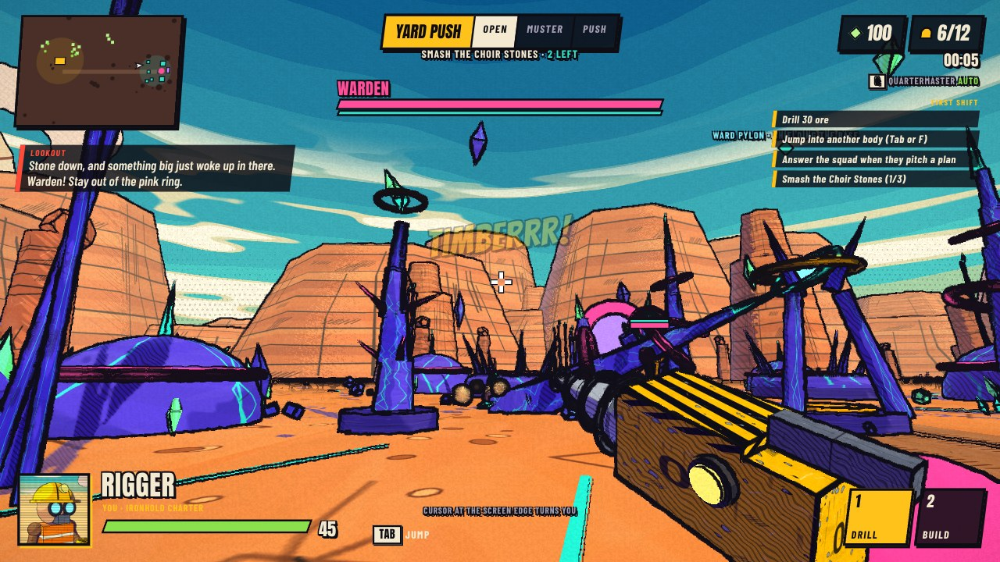

Veyl Lancers use the scenery. Between shots a Lancer ducks behind the nearest rock or pillar and leans out to fire, and squad fire aimed at it from the far side mostly chews up the rock instead. Shoot the cover away, flank it, or drive a body round the side yourself.

## Maps

Pick one on the menu. **Needle's Eye** is the original road east. **Switchback** is a tight canyon at sunset with a long flank. **Glass Flats** is open salt pan with almost no cover.

Each map comes in three sizes, picked on the Skirmish tab or by the lobby host: **Small** (three ore fields out on the map), **Medium** (four) and **Large** (seven, with the outpost about 170 m away). A map number carries its size in the tens: 0 to 2 are Medium, 10 to 12 Small, 20 to 22 Large.

- **Two-sided matches get a fair ore layout.** When both ends run an economy (every skirmish and versus pairing except the classic Ironhold yard against the raid outpost, and never a story job), the ore fields out on the map come in matched pairs. Each field has a twin with the same seams and the same ore, turned round through the middle of the map, so each end has the same walk to every field. An odd field sits the same distance from both ends. `LAYOUT.fair` in `src/data.ts` switches it, `Game.pin()` keeps a running match on its own layout when more than one match shares the page or the server, and `npm run test:rules` checks that no field is more than 8 m nearer one end than its twin is to the other.
- **Overtime is written and switched off.** `OVERTIME` in `src/data.ts` can make every building take more damage, and every tower do less, for each minute past a start time in a two-sided match, with a yellow clock that says how much. In bot tables it halved the matches still undecided at 40 minutes and did not end them, so it stays off until somebody decides how a long match should end.
- **The map starts undiscovered.** The minimap is black until one of your bodies or buildings has seen the ground, dims what nobody is looking at now, and only shows enemy bodies in sight. Ore fields and the Veyl outpost appear once somebody has walked there.
- **New bases.** A Headframe can be built (400 ore) on any open ground short of the Veyl. Riggers bank at the nearest one, each extra one adds eight beds and lets you build around it, and the shift is only lost when the last Headframe falls. The Quartermaster stakes one on the nearest free field once the home seams thin out or the shift runs long, then puts a Watchpost beside it. The raids go for whatever is softest, which is usually the new base.

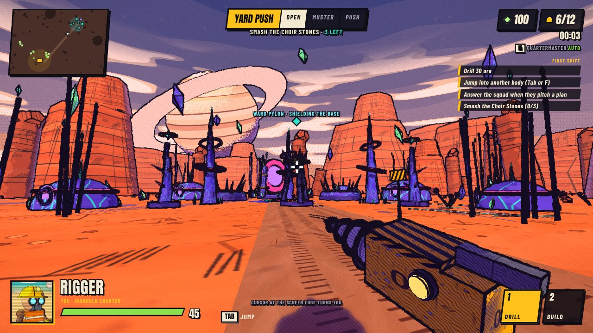
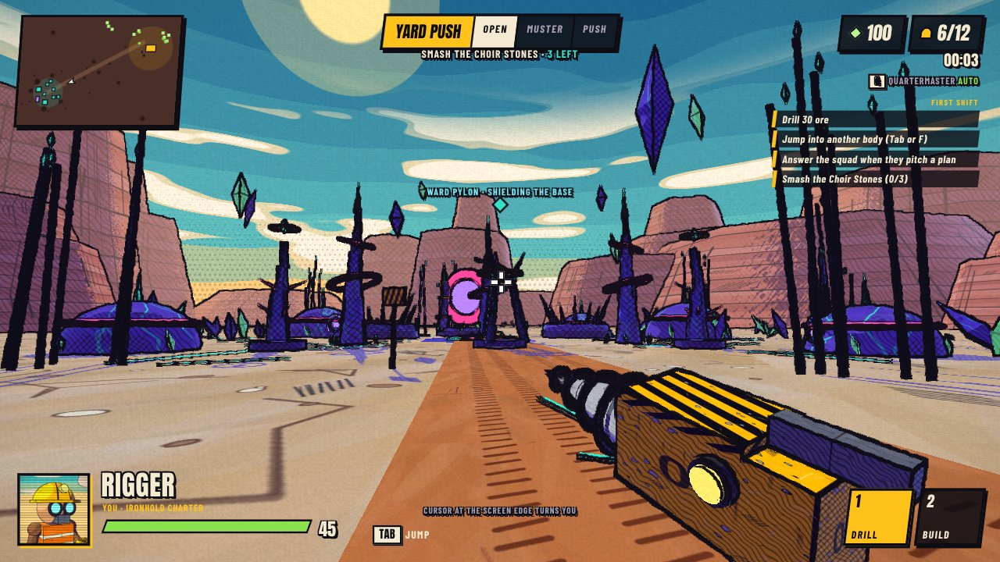

## Campaign

The campaign is a story in four acts and 24 jobs, plus three side jobs. You play Rigger Nineteen, a new hire on the moon Tithe. Act 1 (Dig) plays the Ironhold Charter, Act 2 (Sing) the Veyl, Act 3 (Grow) the Gloam, and Act 4 (Or Else) one job for each side against Charter Security, the company's own troops in grey. Every job teaches part of one side, and cut scenes between jobs are drawn as comic panels in the game's own renderer. Finishing Act 1 unlocks multiplayer. Progress and the ore you bank across the campaign are saved in the browser.

| Act | Jobs | Plays | Maps |
| --- | --- | --- | --- |
| 1. Dig | 1 to 8 | Ironhold, against the Veyl | Needle's Eye, Switchback, Glass Flats |
| 2. Sing | 9 to 15 | the Veyl, against the Gloam and Aggie's crew | The Crack, Glass Flats, Needle's Eye |
| 3. Grow | 16 to 20 | the Gloam, against the Veyl and Charter Security | The Crack, Needle's Eye, First Stone, Drill Site |
| 4. Or Else | 21 to 24 | each side in turn, against Charter Security | Switchback, Needle's Eye, Drill Site |

Three maps exist only for the story: The Crack (Switchback after the canyon floor split), First Stone (the oldest Veyl site, behind old glass walls) and Drill Site (the Charter's drill tower and Deep Charge rigs on the Glass Flats at night). Jobs played from the outpost end run on the same hidden local host as a Veyl or Gloam skirmish, with the job's script running there. A ticked objective stays ticked, so losing a building later does not undo it; timed holds keep their own clocks.

Cut scenes have a few things that come back across all four acts. The Quartermaster stamps NOTED on things and keeps Nineteen's balance in the corner of the panel. Moss only bets against people he likes, because he has never won a bet. Pim names a Veyl Cantor Gary on the first day, and Gary turns up in every act. The Veyl talk through the free version of Phrasebook 3, which counts the words it has left, until Pim pays for the full one. Every message from head office arrives forty minutes late. Each named character has a name tag over their head, because the crew share two body models. Job 15 ends on a choice the player makes in play: walk out from between the Choir Stones, or stay for the last minute of the verse and lose the yard.

Tests: `node tools/run-ts.mjs test/story.ts` runs every job headless and checks the endings. `node tools/run-ts.mjs test/playthrough.ts` plays every job through to a win the way a player would (staking buildings where the build rules allow, training, buying upgrades, walking the body), with the fights skipped, to check that each objective is picked up. `node test/story.mjs` checks cut scenes, the outpost-end jobs and that a win is saved and leads into the next job in a browser.

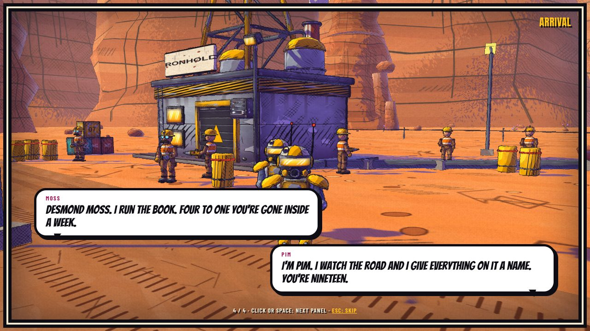
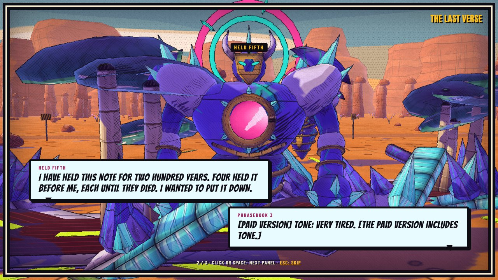
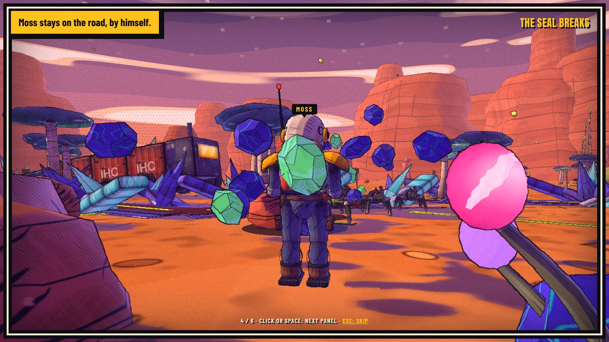
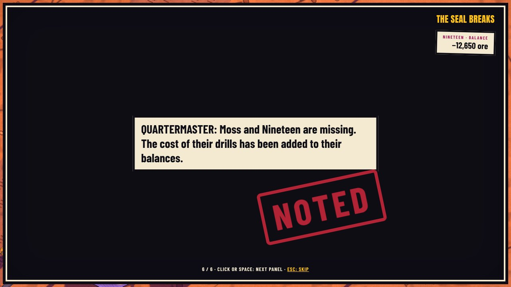
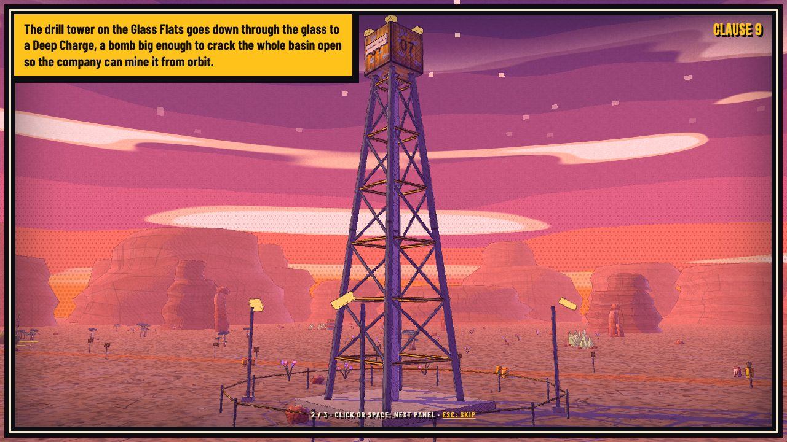
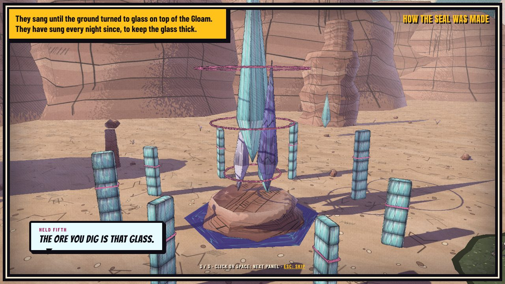

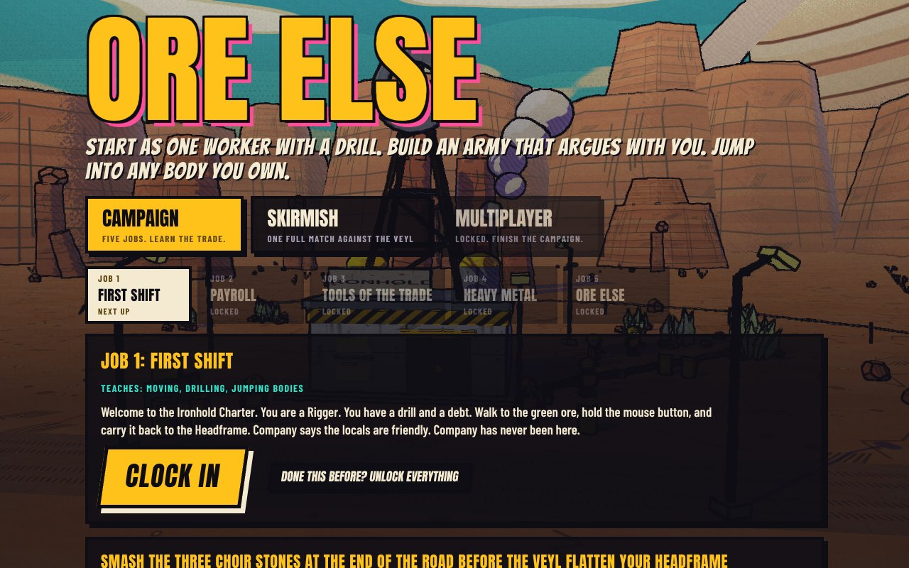

## Multiplayer

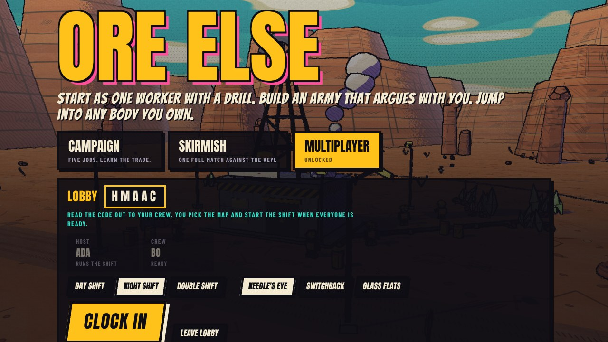
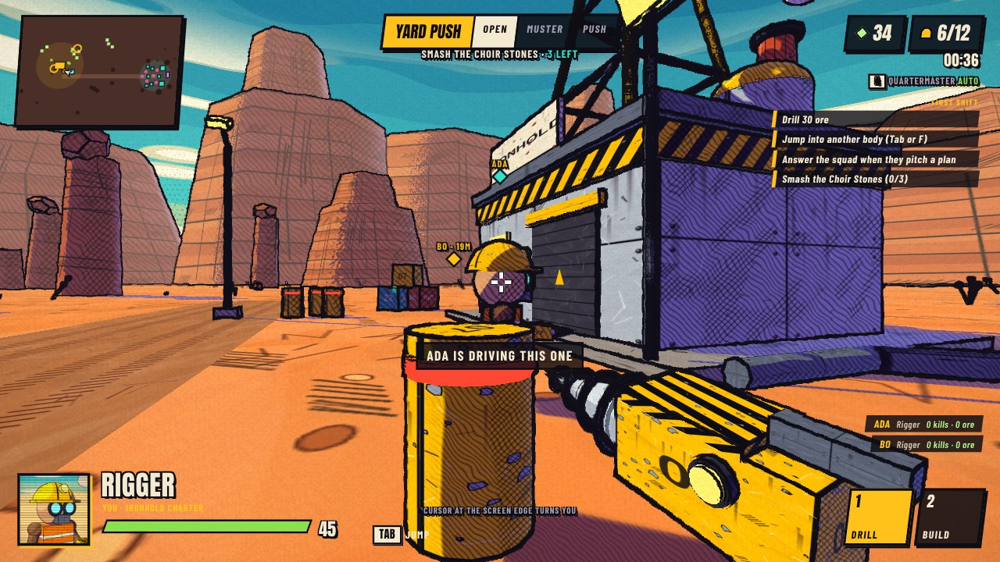

Co-op for up to four players. Everyone shares one Ironhold base and fights the Veyl together, each driving their own body. Jump into any body nobody else is driving. The raids grow with the size of the crew.

Finish Act 1 of the campaign to unlock the Multiplayer tab. One player creates a lobby and reads out the five-letter code, the others join with it, the crew readies up and the host clocks everyone in.

In a match, press B to ping the spot you are looking at and Enter to type to the crew. A panel on the right shows who is driving what, with kills and ore mined. If someone drops, or turns up late, they join the running match with the same code.

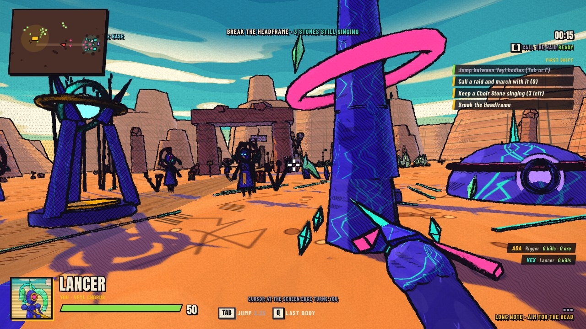

**How each side wins.** Ironhold is few, expensive and long-armed: it wins by out-digging the raids and pushing with a mixed squad (shield in front, rifles in the middle, a Longshot behind). The Veyl are many, free and close-in: they win by never letting the crew settle. Cantors tie up Breachers, Lancers wear down a Gantry, a Warden walks through shields and walkers, and Longshots or a mixed squad answer all three. `node tools/duel.cjs 4` prints the squad against squad table those lines come from.

**Versus.** In the lobby, any player can press Play as the Veyl. When anyone does, the Chorus runs a full economy like the yard does (see Playing as the Veyl below), Veyl players wake up as Tenders at the Choir Stone, and they win by breaking every Headframe. Each Veyl fighter has a second move on right click: the Cantor's Whirl hits everything in reach (and its cuts build a Crescendo while they keep landing), the Lancer's Held Note winds up and goes through a whole line, and the Warden's Low Note gives every Veyl in earshot its shield back. A side with nobody on it is run by bots, so a lobby that is all Veyl plays against an Ironhold bot crew. `node test/versus.mjs` plays one of each side against the other.

Multiplayer needs the game server, because the server runs the match and every player's browser is a window onto it. The server also serves the game page, so there is only one thing to host.

```
npm install
npm run build
npm start          # http://localhost:8080
```

To put it on the internet, deploy the `Dockerfile` to any host that supports WebSockets. `render.yaml` is a ready blueprint for Render. The server listens on `PORT` (default 8080) and answers `/healthz`. Players open the server's address and the lobby connects on its own.

`npm test` starts a local server, joins two headless browsers to one lobby and checks that both see the same match (needs Playwright with Chromium). It also runs `test/server.mjs` (lobbies, sides, reconnecting and junk input, with plain WebSocket clients) and `test/sweep.mjs` (checks for the bugs fixed in the November bug sweep).

How it works: the server runs the same game code as single player at 30 ticks a second and sends every client a snapshot 15 times a second, about 1 KB each. Each client moves and aims its own body, reports its hits, and the server decides health, ore, building, training and the enemy.

## Tech tree

The Ironhold tree has five tiers. Each building needs the one above it standing, some units need a second building, and research comes in chains.

| Tier | Building | Needs | Trains | Research |
| --- | --- | --- | --- | --- |
| 0 | Headframe (more cost 400) | | Rigger | Diamond Bits, Bunk Stacks |
| 1 | Bunkhouse | | Linesman, Breacher (Machine Shop), Patch (Machine Shop), Longshot (Assay Office) | |
| 1 | Depot | | | |
| 2 | Watchpost | Bunkhouse | | |
| 2 | Machine Shop | Bunkhouse | | Hollow Points, Plating, Twin Mounts |
| 2 | Assay Office | Bunkhouse | | Hazard Pay, Long Glass, Field Stitches, Short Fuses |
| 3 | Foundry | Machine Shop | Gantry | Tungsten Core (after Hollow Points), Reactive Plating (after Plating), Servo Legs |
| 4 | Signal Mast | Foundry and Assay Office | | Charter Specials (after Tungsten Core), Vault Plate (after Reactive Plating), Field Welders, Deep Buckets (after Diamond Bits) |

The tables live in `src/data.ts` (`BLD`, `TRAINS`, `UNIT_NEEDS`, `UPGRADES`). The pause screen draws the whole tree with what is standing and bought. The Quartermaster follows the same tree when it runs the yard.

## Balance tools

Two scripts play whole matches in a headless browser at many times real speed, with drawing switched off.

- `npm run sim -- '{"out":2,"map":0,"diff":1,"seed":1}'` plays one bot-against-bot match in Node with no browser (40 minutes of match in about 20 seconds): `home` and `out` name the faction at each end (0 Ironhold, 1 Veyl, 2 Gloam; the same twice is a mirror), on any map code and shift. The result names the winner, with a 2 on the end for the far side of a mirror, and `bdump: [seconds]` prints each side's buildings, ore, bodies and research at those times. The match's own dice are seeded by the map, so `seed` shuffles where the starting workers stand and when each brain first thinks; without that, two runs of one map are the same match. `human: [1, 0]` makes a side turtle (it builds but never says yes to a push), `verbose: 1` prints both sides every two minutes, and `probe: "park"` runs a cheese scenario. `npm run test:rules` runs the checks from the matchup sweep (`test/matchups.ts`) the same way.
- `node tools/table.mjs [seeds] [pairs] [maps] ['{options}']` plays a whole table of bot matches, four at a time, and adds it up: wins for each pairing from each end, mirrors by map, match length, when the first building falls, lead changes, comebacks, quiet time and ore mined a minute. With no arguments it plays ten seeds of all nine pairings on the three Medium maps (270 matches, about a quarter of an hour). Each match is one run of `tools/review.ts`, whose options turn single rules up or down for an experiment (`ot`, `otk`, `reach`, `vhp`, `vdmg`, `cleave`, `bite`, `gnaw`, `cap`, `bud`). `node tools/table.mjs sum dist/table.jsonl` adds up a saved table again.
- `node tools/soak.cjs '[[0,1],[1,1]]'` plays hands-off matches (pairs of map and difficulty) and reports errors, bodies that stop moving, and who won.
- `node tools/monkey.cjs [seconds] [scenario]` mashes every control at random in single player on every map and shift, each campaign job, and split screen co-op and versus, and reports crashes and broken state (NaN positions, bodies off the map, health over the maximum, halves of a split screen that disagree).
- `node tools/bot.cjs <mode> <difficulty> [map]` plays as a scripted first-person player with perfect aim. Modes: `linesman` (walk in alone and shoot), `rigger` (drill rush), `longshot`, `squad` (defend, say yes to pushes, go with them) and `afk`. It exists to find one-trick wins.

The Veyl base answers an attack: guards walk out to whoever is shooting, however far away, and the Reed Gate sends help. It sends much more against one or two attackers than against a full push. Rifles and pistols do little to buildings, so cracking the base takes Breachers, grenades, the Gantry or numbers.

## Split screen

Two players on one machine, no server needed. Pick a map and a shift on the Skirmish tab, choose side by side or stacked, then press **Split screen co-op** to share one side (Ironhold, or the Veyl when the Veyl are picked as your side), or **Split screen versus** to put player two in the Veyl. In versus both sides dig, build and train, and player two wins by breaking every Headframe.

- Player one keeps the keyboard and mouse.
- Player two uses a controller: left stick moves, right stick looks, RT fires, LT aims or raises the shield, A dashes, B is the grenade or ability, X reloads or rotates, Y uses or trains, hold LB for the jump wheel and pick with the D-pad, RB jumps into the body in the crosshair, D-pad up opens the build menu, Start pauses.
- With no controller, player two gets the right-hand side of the keyboard: arrows move, I J K L look, O fires, P aims, H uses, N reloads, M is the ability, `/` opens the build menu, comma and full stop pick, `'` holds the jump wheel, `;` jumps to the target.
- With two controllers, player one can use the first as well as the keyboard, and player two takes the second.

It is built on the online co-op code. `src/split.ts` runs a silent copy of the match inside the page, the way the server does, and each half of the screen is an ordinary client of it. Both halves draw through one renderer into their own rectangle (`ViewPipe` in `src/gfx.ts`), and each has its own HUD. `node test/split.mjs` plays a short match in a headless browser.

## Phones and tablets

The game checks the device when it loads. On a phone or tablet (a touch screen that is the main way to point) it switches to touch controls by itself; on a desktop, including a laptop with a touch screen and a mouse, it keeps the keyboard and mouse. A touch on a machine that was not spotted also switches the controls on. Options has a **Touch controls** setting (Auto, On, Off) to override it.

- Left half of the screen: put a thumb down anywhere and it becomes the move stick. Push it all the way forward to sprint.
- Right half: drag to look. The Fire and Aim buttons turn the view too while held, so you can shoot and aim with one thumb.
- Buttons on the right change with the body you are in: Fire (Drill, Hum, Chew, Bite, Place), Aim (Kick, Shield, Scope, Salvo, Whirl, Pounce and so on), Dash, the ability (Grenade, Patch, Stomp), Reload (Rotate in the build menu) and Jump.
- Workers get a Build button on the left. In the build menu tap a row or use the arrows, then Place; Aim becomes Cancel.
- Jump opens the bodies you own; tap one to jump into it. Back returns to the last body.
- Whatever the prompt offers (train a unit, buy research, jump into the body in the crosshair, answer the squad) shows up as big buttons in the middle of the screen.
- The bar at the top has pause, the Quartermaster, Squad and Send, and in multiplayer Ping and Say.

Starting a match on a phone goes full screen and asks the browser to hold the screen sideways; held upright it asks you to turn it. The HUD is laid out larger and moved off the thumbs, tips that name keys name the buttons instead, and the picture is drawn at one pixel per screen point to keep the frame rate up. Split screen and key rebinding are hidden on touch screens. The code is `src/touch.ts`; `node test/touch.mjs` drives it on emulated iPhone, Pixel and iPad screens with real multi-touch.

## Trailer and landing page

`docs/index.html` is a landing page with the trailer at the top. Turn on GitHub Pages for the `docs` folder to publish it. `docs/trailer.mp4` is rendered from the real game, one frame at a time, by `test/trailer.cjs`, a script that stages seven shots and steps the simulation a twenty-fourth of a second per frame. It is silent, because the game's sound is synthesised live in the browser.

## Options

The Options tab on the menu has mouse speed, volume and music, four picture settings (Auto adjusts the resolution to keep the frame rate up, Low also redraws shadows less often), colour-blind friendly team colours (blue for your side and orange for the other on health bars and the minimap), and key rebinding for every keyboard action. Prompts in the game show the keys you chose. Everything is saved in the browser. There is also a frame rate readout, which shows frames a second, the worst frame in the last half second, the render size and the unit count.
