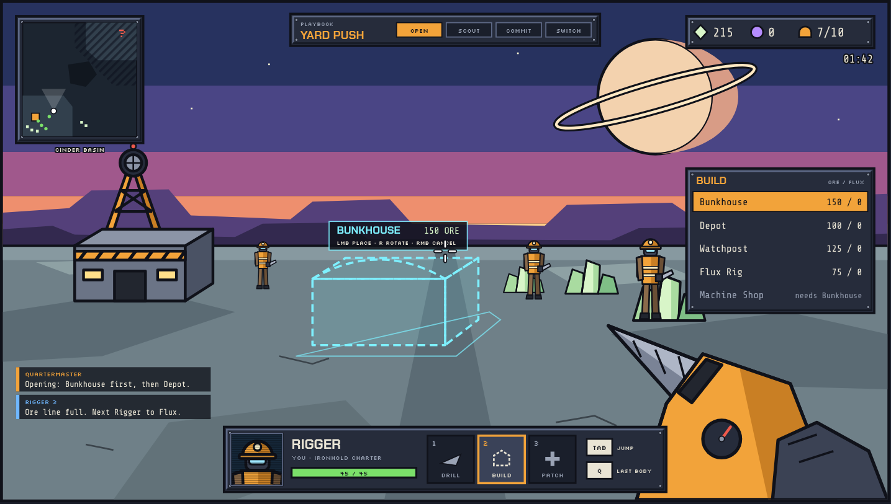
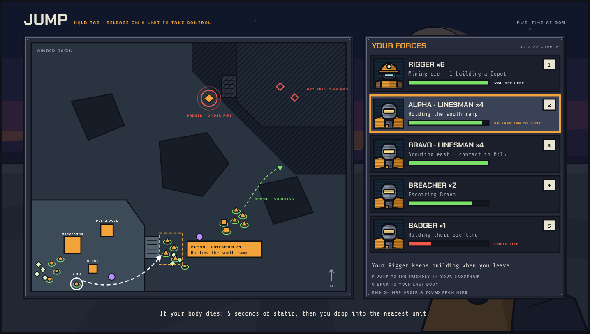
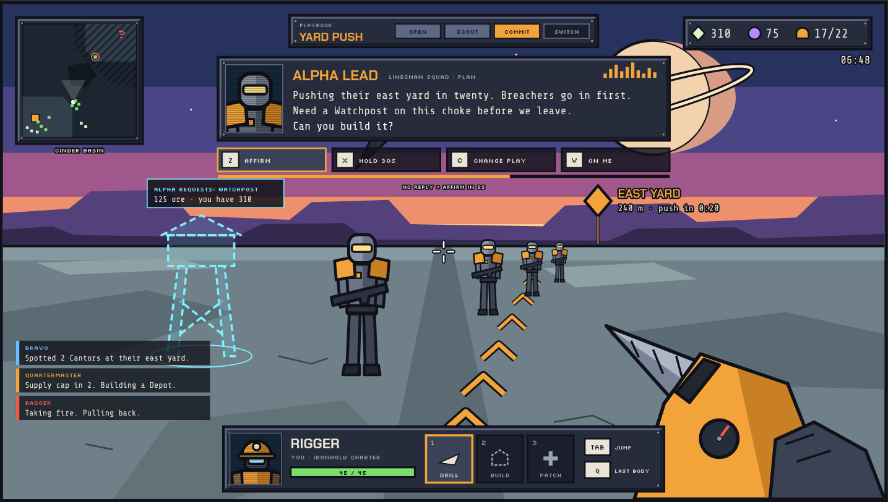
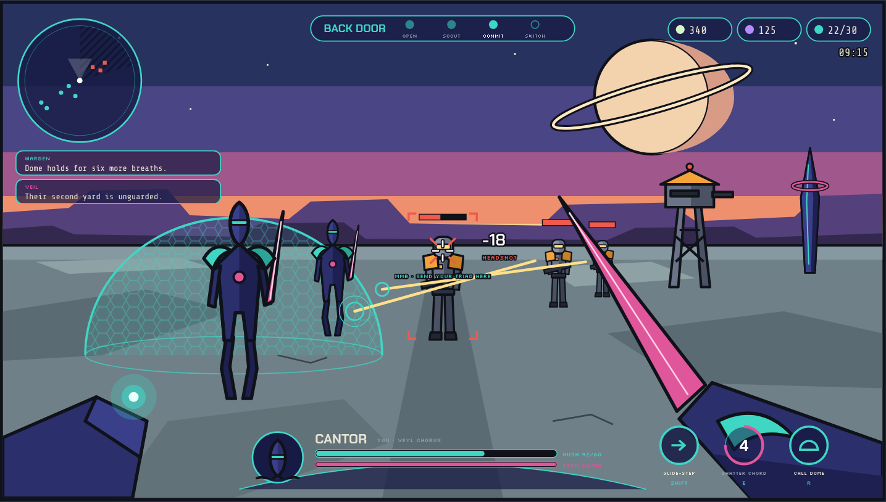

# Proxy Front — Game Design Document (Phase 1)

*Working title. Status: design for review, no game code yet.*

Proxy Front is a first-person real-time strategy game. You start a match as a single worker with a drill. You mine, you build, your base starts producing an army, and at any moment you can jump into the body of any unit you own. Everything you are not controlling is run by AI teammates who follow recognisable RTS strategies and tell you out loud what they are about to do.

The mockups that go with this document are in [`mockups/index.html`](mockups/index.html) (open it in a browser). Screenshots are embedded below.

## 1. An original game in a familiar genre

The brief was a first-person take on classic 90s base-building RTS play with two asymmetric factions: a human industrial side and a psionic alien side. This design keeps that play pattern and that feeling, and builds its own world on top of it. The factions, units, names, story and art here are original, so the game can be shown, shared and eventually sold without leaning on anyone else's property. The art direction tips its hat to the era (chunky bevelled consoles, pixel type, talking unit portraits, green selection rings, a top-down tactical map) without copying any one game's look.

## 2. Design pillars

1. **One body at a time, any body you own.** The player is always inside exactly one unit. Swapping is fast, cheap and expected. It is the main verb of the game.
2. **The army has a plan and says it out loud.** AI squads never act silently. Before they commit to anything they announce it, and the player can approve, delay or redirect with one key.
3. **Macro is a choice, not a chore.** A player who loves building can do every build order by hand as a worker. A player who wants to shoot can hand the economy to the AI and never open the build wheel.
4. **Small armies, readable fights.** Dozens of units, not hundreds. Every unit on the field matters enough to be worth jumping into.
5. **Ink and flat colour.** Cel shading with heavy outlines, so that a unit's faction, type and health read at a glance from eye level.

## 3. The match loop

| Minute | What the player is usually doing | What the AI is doing |
|---|---|---|
| 0:00 to 2:00 | Playing a Rigger (worker). Mining ore, placing the first production building. | Other workers mine. The Quartermaster follows the opening of the chosen playbook. |
| 2:00 to 5:00 | First combat units appear. Player chooses whether to stay a worker or jump into the first squad to scout. | Squad leads form squads of four, scout, and call out what they see. |
| 5:00 to 12:00 | Jumping between the front line, a harassing vehicle and the base as needed. | Squads execute the playbook's commit phase, ask for support, call for retreats. |
| 12:00 to 20:00 | Leading the decisive push or defending against one. | Transition phase: tech switch, expansion or all-in depending on how the game is going. |

A match ends when one side loses its headquarters and all production buildings. Target match length is 12 to 20 minutes.

### Starting state

Each side starts with one headquarters, six workers and enough resources for one more worker. The player spawns inside one of the workers.

### Resources

- **Ore** is mined by workers from surface deposits and carried back to the headquarters. Everything costs ore.
- **Flux** is vented gas, collected by building an extractor on a vent. Advanced units and upgrades cost flux.
- **Supply** limits army size. Each faction raises it with its own structure. The cap is 40 in the first prototype and 60 in the full game.

## 4. Making an RTS work in first person

These are the places where a straight port of top-down RTS rules would stop being fun at eye level, and what this design does about each one.

### 4.1 Building from the ground

Problem: placing buildings needs an overview, and a first-person camera does not have one.

- Key `2` opens build mode. A short list shows what you can afford. The selected building appears as a hologram blueprint on the ground where you are looking, snapping to a coarse grid. Left click places, `R` rotates, right click cancels.
- A placed blueprint is a build job. Ironhold workers must stand at it and weld (hold left click). More workers on one job speed it up. Veyl Tuners plant a seed and the structure grows by itself.
- Production buildings have a physical console on the outside. Walk up, press `E`, queue units from a small panel. You can also queue from the tactical map without walking there.

### 4.2 The economy without babysitting

Problem: watching workers is the least exciting part of an RTS to do in first person.

- AI workers are always competent: they saturate ore, move to flux when told, and rebuild what dies.
- A player-controlled worker is better than an AI one. The drill has a timing mechanic (release on the beat for a bonus chunk) that makes a human worker mine about 50% faster. Playing a worker early is a real economic choice.
- The **Quartermaster** is the macro AI. It has three settings per area (economy, production, tech): *Auto* (it decides and tells you), *Assist* (it proposes, you confirm with one key), *Manual* (it stays silent). Default is Auto for PvE and Assist for PvP.

### 4.3 Jumping between units

Problem: the player needs to be where the action is without losing track of everything else.

- Hold `Tab` to open **Jump**. The world dims and a top-down tactical map appears with a list of everything you own, grouped by squad, with each group's current task. Release `Tab` on a unit to be inside it.
- `F` while looking at a friendly unit jumps straight into it. `Q` returns to your previous body.
- The body you leave keeps doing what it was doing. A worker goes back to mining, a squad lead keeps following the current play.
- There is a three second cooldown between jumps so swapping cannot be used to dodge every bullet.
- If your body dies you get five seconds of static (**signal lost**) and then drop into the nearest surviving unit. If you have no units left but still have a headquarters, it produces one free worker for you once a minute.
- In PvE, time slows to 30% while Jump is open. In PvP it does not.

### 4.4 Why control a unit at all

Problem: if AI units fight as well as the player, there is no reason to jump. If the player's unit is hugely stronger, the game becomes a hero shooter with a base attached.

- A possessed unit has the same health and damage as an AI one. No stat bonus.
- The player's edge is skill and judgement: headshots, flanking, focus fire, and above all **active abilities**. AI units use their abilities in a simple, predictable way. A human uses them well.
- The squad of the unit you are in follows you. You become its lead, so a jump is also a way to take personal command of a push.

### 4.5 Commanding without a cursor

- **Ping orders.** Look at a spot and press middle mouse: your current squad moves there. Look at an enemy: they focus it. Look at a friendly building: they defend it.
- **Reply wheel.** When a squad calls out a plan, four one-key answers are available (see section 6).
- **Tactical map orders.** With Jump open you can right click to send any squad anywhere, the way you would in a top-down RTS. This is the fallback for anything the eye-level tools cannot do.

### 4.6 Scale, time to kill and maps

- Armies are 20 to 40 units a side in squads of four to six.
- Basic infantry survives roughly one to three seconds of focused fire. Fast enough to feel like a shooter, slow enough that a fight between squads is a readable event.
- Maps are compact: two main bases, two natural expansions, three routes between them, and high ground that matters because eye level cannot see over it. The first map is **Cinder Basin**.
- Fog of war is literal. You know what your units can see. The minimap and tactical map show shared vision and the last known position of enemies.

## 5. Factions

### 5.1 Ironhold Charter

A chartered mining company that armed its workforce when the claims got contested. Welded steel, hazard stripes, diesel and floodlights. Units are cheap, numerous and rely on ranged fire and fortification.

**Faction rules.** Buildings can go anywhere on buildable ground. Workers must stay on a build job until it finishes. Structures can be repaired. Supply comes from Depots.

| Unit | Role | Cost (ore/flux) | Supply | What makes it fun to control |
|---|---|---|---|---|
| Rigger | Worker | 50 / 0 | 1 | Drill timing, building, emergency repairs under fire |
| Linesman | Rifle infantry | 50 / 0 | 1 | Accurate rifle, sprint, frag charge on a cooldown |
| Breacher | Close assault | 75 / 25 | 2 | Riot shield you can raise to cover the squad, shotgun |
| Patcher | Medic and mechanic | 50 / 50 | 1 | Heal beam, deployable cover plate |
| Badger | Fast buggy | 100 / 50 | 2 | Drive and shoot, built for raiding worker lines |
| Kiln | Mortar carrier | 150 / 100 | 3 | Must brace before firing, arcing shots you aim with a range ladder |
| Kite | Transport VTOL | 125 / 100 | 2 | Flies six infantry over the high ground |

| Structure | Purpose | Cost |
|---|---|---|
| Headframe | Headquarters, worker production, ore drop-off | 400 / 0 |
| Depot | +8 supply | 100 / 0 |
| Bunkhouse | Infantry production | 150 / 0 |
| Flux Rig | Collects flux from a vent | 75 / 0 |
| Watchpost | Defensive turret, can be garrisoned | 125 / 0 |
| Machine Shop | Vehicles | 200 / 100 |
| Foundry | Weapon and armour upgrades | 150 / 100 |
| Airpad | Kite production | 150 / 150 |

### 5.2 Veyl Chorus

A species that thinks and builds with sound. Their structures are grown from glass-like reed and coral, tuned to a shared resonance. Teal light, magenta edges, dark indigo bodies. Units are few, expensive and durable, with a regenerating barrier called **Hush**.

**Faction rules.** Structures can only be seeded inside the resonance field of a Choir Stone. A Tuner plants a seed and walks away; the structure grows on its own. Every unit has Hush, a barrier that recharges after a few seconds out of combat. Structures cannot be repaired but their Hush regenerates. Capacity (supply) comes from Choir Stones.

| Unit | Role | Cost (ore/flux) | Supply | What makes it fun to control |
|---|---|---|---|---|
| Tuner | Worker | 50 / 0 | 1 | Seeds buildings quickly, can retune a Choir Stone to boost nearby growth |
| Cantor | Melee vanguard | 100 / 0 | 2 | Resonance blade, short dash (Glide-step), shockwave (Shatter Chord) |
| Lancer | Ranged | 125 / 50 | 2 | Charged tone-lance shot that pierces a line of targets |
| Veil | Cloaked scout | 75 / 75 | 1 | Invisible while still, marks targets for the whole army |
| Warden | Floating support | 100 / 100 | 2 | Projects a Hush Dome that blocks incoming fire |
| Monolith | Heavy walker | 250 / 150 | 4 | Slow sweeping beam, tall enough to see over walls |
| Wisp | Air skirmisher | 150 / 100 | 2 | Fast flier, strong against vehicles |

| Structure | Purpose | Cost |
|---|---|---|
| Anchor | Headquarters, worker production, ore drop-off | 400 / 0 |
| Choir Stone | +8 capacity, projects a resonance field | 100 / 0 |
| Reed Gate | Infantry production | 150 / 0 |
| Flux Bloom | Collects flux from a vent | 75 / 0 |
| Sentinel Reed | Defensive emitter | 150 / 0 |
| Deep Hall | Heavy units | 200 / 100 |
| Loom | Upgrades and air units | 150 / 150 |

### 5.3 Asymmetry in first person

Ironhold fights at range, in numbers, from cover it builds. Playing Ironhold feels like a squad shooter. Veyl fights up close or with precise single shots, with fewer bodies that each take longer to kill. Playing Veyl feels like an ability-driven action game. Ironhold wins by trading efficiently and out-producing. Veyl wins by keeping units alive long enough for Hush to recharge.

## 6. AI teammates: playbooks and callouts

### 6.1 Three layers of AI

1. **Quartermaster** (one per side). Runs economy, production and tech according to the playbook. Decides when to expand and what to build next.
2. **Squad leads** (one per squad). Turn playbook goals into movement and fights: where to stand, when to push, when to pull back. Squad leads are the voices the player hears.
3. **Unit brains.** Aiming, cover, ability use, pathfinding.

### 6.2 Playbooks

A playbook is a scripted strategy with four phases: **Opening**, **Scout**, **Commit**, **Transition**. Each phase has a build order for the Quartermaster, goals for the squad leads, and exit conditions. The playbooks are generalised from the standard strategy archetypes that RTS players have used for decades. The player picks one before the match and can change it mid-game.

| Playbook | Archetype | Opening | Commit | Risk |
|---|---|---|---|---|
| Yard Push | Timing attack | One production building, steady workers, expand at 3:30 | Attack at 7:00 with first upgrade and 12 to 16 units | Dies to an early rush if scouting is late |
| First Light | Early rush | Two production buildings before the first supply building, cut workers | Attack at 3:00 with 6 to 8 basic units | Behind on economy if the attack fails |
| Deep Claim | Fast expand | Second headquarters before any army | Defend with turrets, then out-produce from minute 8 | Weak for the first five minutes |
| Back Door | Harassment | Fast vehicle or cloaked scout | Raid the enemy worker line repeatedly while expanding | Raiders are fragile |
| Forward Yard | Proxy | Production building hidden near the enemy base | Constant reinforcement stream from close range | All-in if the building is found |
| Iron Curtain | Contain | Fast defensive structures at the enemy's exits | Starve them of expansions, tech up behind the wall | Slow, loses to air |
| Long Game | Turtle into tech | Heavy static defence, fast top-tier tech | One overwhelming late push | Cedes the map |
| Last Shift | All-in | Pull most workers to fight alongside the army | One attack, win or lose | No second chance |

The enemy AI commander in PvE uses the same playbooks, and its difficulty is mostly how well it scouts and how cleanly it switches play.

**Adapting.** At the end of the Scout phase and whenever a major fact changes (expansion lost, enemy tech spotted), the Quartermaster re-evaluates. If the current play is a bad matchup for what was scouted, it proposes a switch out loud: "They're going air. Recommend Long Game with Watchposts." The player confirms or refuses.

### 6.3 Callouts

Every significant AI decision produces a callout. A callout is a small structured message, which is what makes it possible to display, voice, mark in the world and respond to.

| Field | Example |
|---|---|
| Speaker | Alpha Lead (Linesman squad) |
| Intent | Attack |
| Target | East Yard (enemy expansion) |
| When | In 20 seconds |
| Request (optional) | Watchpost at the south choke |
| Priority | Plan |

The player experiences a callout four ways at once:

- **Voice.** A short spoken line with the unit's character.
- **Portrait panel.** The speaker's portrait with the line as text, in the style of a classic RTS unit portrait.
- **World markers.** The target gets a diamond marker with distance and countdown. The route is drawn on the ground. A requested building appears as a ghost blueprint where the squad wants it.
- **Feed.** A short history in the corner, colour coded by priority.

**Priorities.** *Alert* (red: under attack, unit lost) interrupts anything. *Plan* (amber: about to act) plays in order. *Info* (blue: scouting reports, economy notes) is feed-only unless the channel is quiet. No more than one spoken callout every six seconds except alerts.

**Replies.** While a Plan callout is on screen:

| Key | Reply | Effect |
|---|---|---|
| `Z` | Affirm | Squad proceeds. If a request was made and you can fulfil it, it becomes your objective. |
| `X` | Hold | Squad waits 30 seconds and asks again. |
| `C` | Change play | Opens the playbook list. |
| `V` | On me | Squad drops its plan and follows you. |

No reply counts as Affirm after five seconds. The army never stalls waiting for the player.

### 6.4 The scenario from the brief

You are playing a Rigger at the south choke. Alpha squad jogs past. Alpha Lead's portrait opens: "Pushing their east yard in twenty. Breachers go in first. Need a Watchpost on this choke before we leave. Can you build it?" A ghost Watchpost appears on the ground beside you and a diamond marks the east yard. You press `Z`, place the Watchpost, and weld it while the squad moves out. Thirty seconds later the feed turns red: "Badger: taking fire, pulling back." You press `Tab`, pick the Badger, and you are behind the wheel.

## 7. Modes

- **Skirmish (PvE).** One player and their AI army against an AI commander. Three difficulties. This is the first mode built.
- **Co-op (PvE).** Two players share one faction and one army against a stronger AI commander. Both can jump into any unit the other is not using.
- **Duel (PvP).** One against one, each with their own AI army. Same rules, no time slow.
- **Later:** two against two.

## 8. Controls (keyboard and mouse)

| Input | Action |
|---|---|
| `WASD`, mouse | Move, look |
| Left / right mouse | Primary / secondary (per unit) |
| `Shift`, `E`, `R` | Unit abilities |
| `1` `2` `3` | Tool or weapon slots (worker: drill, build, repair) |
| `Tab` (hold) | Jump: tactical map and unit list |
| `F` | Jump into the friendly unit under the crosshair |
| `Q` | Jump back to previous body |
| Middle mouse | Ping order for current squad |
| `Z` `X` `C` `V` | Reply to a callout |
| `M` | Toggle full tactical map |

## 9. HUD

See the mockups for layout. The principles:

- **Faction-specific frames.** Ironhold's HUD is riveted steel panels with pixel type. Veyl's is thin curved glass lines and soft glows. Swapping faction changes how the whole screen feels.
- **Always visible:** minimap, resources and supply, playbook phase, current body's portrait, health and abilities, callout feed.
- **On demand:** build list (build mode), reply keys (during a callout), Jump overlay.
- **In the world, not on the screen, where possible:** objective diamonds, route chevrons, ghost blueprints, enemy health bars.

## 10. Art direction

### Look

- **Shading.** Two flat tones per surface (lit and shadow) with a hard edge between them. No smooth gradients. A thin rim light on the shadow side to separate characters from the background.
- **Outlines.** Dark ink outlines on every character, vehicle and building, thicker on silhouettes than on interior detail.
- **Shapes.** Chunky, slightly exaggerated proportions. Ironhold is boxes, wedges and bolts. Veyl is tall, tapered and curved.
- **Team colour.** Shoulder pads, stripes and lights carry the team colour so sides are readable in a mirror match.
- **World.** Cinder Basin is a slate grey ash plain under a banded dusk sky with a ringed planet. Grey ground lets both factions' colours stand out.

### Palette

| Use | Colour |
|---|---|
| Ink outline | `#10121a` |
| Ironhold primary | `#f2a33a` amber |
| Ironhold metal | `#6b7486` / shadow `#4a5264` |
| Veyl body | `#2b2f6b` indigo |
| Veyl light | `#3fd6c4` teal, `#e0569b` magenta |
| Ground | `#6f8088` / shadow `#55666e` |
| Sky bands | `#27325f`, `#4a4585`, `#a0588c`, `#ee8f6e`, `#ffd08a` |
| HUD selection green | `#7be06a` |
| Alert | `#ef5a4c` |

### Nods to 90s RTS games

- A heavy bevelled console at the bottom of the screen with a framed unit portrait.
- Pixel type for numbers and labels.
- Green selection rings under friendly units on the tactical map.
- Short, characterful acknowledgement lines when you jump into a unit.
- The top-down tactical map itself: holding `Tab` briefly turns the game back into the genre it came from.

## 11. Mockups

Open [`mockups/index.html`](mockups/index.html) for the full sheet. Stills:

**Starting as a Rigger: mining, build mode and the Ironhold HUD**

**Jump: swapping control to another unit**

**A squad calls out its plan and asks for help**

**Playing the other side: a Veyl Cantor in combat**

## 12. Proposed build plan

Recommended technology: TypeScript with three.js in the browser. It supports toon shading and outlines well, a build can be shared as a link with nothing to install, and it can be built and tested automatically. The game simulation (economy, AI, combat rules) is kept separate from rendering so that it can run on a server for PvP later. Unit and building models can be made in Blender.

| Milestone | Contents | Proves |
|---|---|---|
| M1 Greybox slice | Cinder Basin blocked out, Ironhold only, Rigger mines and builds, Bunkhouse makes Linesmen, Jump works, static enemy targets | The core loop of worker, build, jump is fun |
| M2 Talking army | Squad leads, Yard Push and First Light playbooks, callouts with replies, Quartermaster on Auto | AI teammates feel like teammates |
| M3 The enemy | AI commander opponent, win and lose conditions, fog of war, PvE skirmish playable start to finish | A full match works |
| M4 Veyl Chorus | Second faction with Hush, resonance fields and its own HUD | Asymmetry works in first person |
| M5 Art pass | Cel shader, outlines, real models, voice lines, HUD art | The look |
| M6 PvP | Server-authoritative simulation, 1v1 Duel | Multiplayer |

## 13. Open questions for review

1. **Name.** Is "Proxy Front" acceptable as a working title?
2. **Platform.** Browser first (recommended above), or a desktop engine such as Godot or Unreal?
3. **Player power.** This design gives a possessed unit no stat bonus. Would you rather the player's unit be noticeably stronger?
4. **Default autonomy.** Should the AI run the economy by default (current design), or should new players be asked to build by hand first?
5. **Match length.** 12 to 20 minutes is the target. Shorter?
